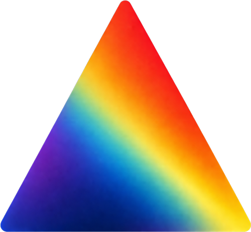

<p align="center">
  
</p>

<h1 align="center">Prism</h1>

<p align="center">
  <a href="https://www.npmjs.com/package/@synthesisengineering/prism">
    
  </a>
  <a href="https://www.npmjs.com/package/@synthesisengineering/prism">
    
  </a>
  
  <a href="https://github.com/synthesiseng/prism/actions">
    
  </a>
  <a href="https://github.com/synthesiseng/prism/blob/main/LICENSE">
    
  </a>
</p>

<p align="center">
  <a href="https://runprism.dev">Docs</a>
</p>

HTML-in-Canvas is coming to browsers. Past the cool demo, it gets messy.
Prism handles the lifecycle so you don't have to.

**Prism is a runtime for managed HTML surfaces inside canvas applications.**

Author visual surfaces with HTML/CSS/SVG. Compose them inside Canvas 2D workflows. Ship data visualizations, design tools, generative art, interactive editors and more.

> **Note:** Native qualification covers Chrome for Testing 158.0.8115.0 on macOS ARM64 with `chrome://flags/#canvas-draw-element` enabled and Chromium sandboxing enabled. Other browser configurations are not qualified. Fallback draws placeholders, not HTML snapshots.

---

## How It Works

Your app owns the scene, drawing model, animation loop, and state. Prism owns the lifecycle for DOM-authored canvas surfaces — registration, bounds, paint, invalidation, readiness, coordinate helpers, and cleanup.

## Built With Prism

- [Atlantic](https://atlantic.runprism.dev) — North Atlantic tropical cyclone tracker, 2000–2025
- [Composer](https://composer.runprism.dev/) — OG image generator
- [Atelier](https://atelier.runprism.dev/) — Generative type art

## Installation

Install the published alpha.9 package:

```sh
pnpm add @synthesisengineering/prism@0.1.0-alpha.9
```

## Agent Skill

Using an AI coding agent? Install the Prism runtime skill:

```sh
npx skills add synthesiseng/prism --skill prism-runtime
```

The skill teaches agents the Prism runtime contract:

- import from the package root: `@synthesisengineering/prism`
- register HTML/CSS/SVG DOM nodes as surfaces
- draw surfaces inside `onPaint()`
- wait for `document.fonts.ready` and `runtime.paintOnce()` before export
- avoid `html2canvas`, `dom-to-image`, raw `drawElementImage()`, and deep imports

Source: [`skills/prism-runtime/SKILL.md`](skills/prism-runtime/SKILL.md).

## Quickstart

```ts
import { CanvasRuntime } from "@synthesisengineering/prism";

const runtime = new CanvasRuntime(canvas, { backend: "auto" });
runtime.start();
```

Register surfaces when you need them:

```ts
const surface = runtime.registerSurface(element, {
  bounds: { x: 0, y: 0, width: 1200, height: 630 }
});

runtime.onPaint(({ drawSurface }) => {
  drawSurface(surface);
});
```

## Export Readiness

Use `paintOnce()` to wait for one complete paint pass before exporting:

```ts
await document.fonts.ready;
await runtime.paintOnce();

const blob = await new Promise<Blob | null>((resolve) => {
  canvas.toBlob(resolve, "image/png");
});
```

## Backend Modes

Prism prefers native HTML-in-Canvas and falls back automatically:

```ts
new CanvasRuntime(canvas, { backend: "auto" }); // default
new CanvasRuntime(canvas, { backend: "native" }); // native only
new CanvasRuntime(canvas, { backend: "fallback" }); // compatibility only
```

```ts
if (runtime.backendKind !== "native") {
  console.warn("Compatibility mode draws placeholders, not HTML.");
}
```

The fallback backend draws placeholders, not HTML snapshots. Native is the target.

## Coordinate Spaces

Surface bounds and input coordinates use CSS pixels. Direct drawing inside `onPaint()` uses canvas backing-store pixels.

Use runtime helpers when aligning manual canvas drawing with surface coordinates:

```ts
runtime.onPaint(({ ctx, drawSurface }) => {
  drawSurface(surface);

  const size = runtime.cssLengthToCanvasPixels(24);
  ctx.fillRect(0, 0, size, size);
});
```

Helpers: `clientToCanvasPoint()` · `cssLengthToCanvasPixels()` · `cssPointToCanvasPixels()`

## Surface Lifecycle

```ts
// Register
const surface = runtime.registerSurface(element, {
  bounds: { x: 0, y: 0, width: 320, height: 180 }
});

// Update bounds
surface.setBounds({ x: 24, y: 32, width: 360, height: 220 });

// Remove
runtime.unregisterSurface(surface);
// or
surface.dispose();

// Destroy runtime
runtime.destroy();
```

## API

```ts
import { CanvasRuntime } from "@synthesisengineering/prism";
import type {
  CanvasBackendKind,
  CanvasBackendPreference,
  CanvasPoint,
  CanvasRuntimeOptions,
  CanvasSurface,
  PaintHandler,
  SurfaceBoundsInput,
  SurfaceOptions,
  UpdateHandler
} from "@synthesisengineering/prism";
```

### CanvasRuntime

```ts
new CanvasRuntime(canvas, options);
```

**Options:** `backend: "auto" | "native" | "fallback"`, `nativePaintTimeoutMs`

**Properties:** `canvas` · `width` · `height` · `pixelRatio` · `backendKind` · `diagnostics`

**Methods:** `registerSurface()` · `unregisterSurface()` · `onUpdate()` · `onPaint()` · `invalidate()` · `paintOnce()` · `start()` · `stop()` · `destroy()` · `clientToCanvasPoint()` · `cssLengthToCanvasPixels()` · `cssPointToCanvasPixels()`

### CanvasSurface

Returned by `registerSurface()`. Do not construct directly.

**Properties:** `element` · `isDisposed`

**Methods:** `getBounds()` · `setBounds()` · `dispose()`

## Native lifecycle

The current native path uses canvas `content="drawable"` and surface `drawable`.
Surface bounds set the native source's CSS width and height as well as its drawing
rectangle. The browser synchronizes native input geometry; application CSS
transforms are preserved.

Prism applies layout sizing before the browser snapshot. A size change made inside
`onPaint()` defers drawing until a subsequent paint has the new layout; `paintOnce()`
remains pending until that pass completes. Function-based bounds are still evaluated
when `drawSurface()` is called, so their first attempted paint can also be deferred.
Retries share the original visible-time timeout budget. Keep paint handlers
repeatable: a deferred pass can invoke them again, and drawing already performed
in an incomplete pass is not rolled back.
Application CSS transforms are preserved. Prism never compensates for a browser
hit-testing failure by rewriting transforms or pointer coordinates.

A canvas has one live runtime, and an element has one active surface within this
module instance. Duplicate registration throws, including within the same runtime.
Dispose or unregister before registering an element again. On release, Prism restores
an initial attribute or style property only if its current value still matches
Prism's last write. Application changes to other values survive cleanup, including
CSS transforms. This also applies to each per-frame `pointer-events` and `inert`
write. If an application writes exactly Prism's value, that write is indistinguishable
and cleanup restores the initial value. DOM parent placement is restored as before.

`stop()` stops animation, leaving explicit `paintOnce()` requests active.
Concurrent callers share the next pass; requests made inside a paint handler wait
for a later pass. `destroy()` rejects outstanding requests and releases resources.

Pending native `paintOnce()` callers own a visible-time diagnostic deadline
(`nativePaintTimeoutMs`). Invalidation without waiting callers does not arm a
deadline. A caller joining an outstanding invalidation starts its budget then;
repeated invalidation and concurrent callers do not reset it.
Hidden time pauses the remaining budget without resetting it; a paint completed
while hidden still succeeds. The default is provisionally 2000 ms and is not a
browser scheduling guarantee or a measured performance target.

`diagnostics` reports backend, capability and native health (`idle`, `pending`,
`healthy`, `failed`). Capability describes API presence, not verified rendering.
`PrismNativeError` reports `paint-timeout` or `draw-failed`; draw failures preserve
the original exception as `cause`. Catching a failed `drawSurface()` inside an
application handler does not make that pass successful: its waiting callers still
reject and diagnostics retain the native failure, even if a later draw in the
same pass succeeds. A later successful paint can restore health.
Application paint-handler exceptions reject the callers waiting for that pass with
the original thrown value. When none are waiting, Prism calls `reportError()`.
Application exceptions do not become native errors, enter `lastError`, or mark
platform health failed; a delivered native pass can be healthy even when app code
throws. A request for a later pass remains pending.
The backend never changes silently after construction. Legacy or partial native
API shapes are rejected in forced native mode; legacy users can pin alpha.8.

[Hosted native qualification](https://github.com/synthesiseng/prism/actions/runs/40217890396)
passed for Chrome for Testing 158.0.8115.0 on macOS ARM64 with
`CanvasDrawElement` and Chromium sandboxing enabled. This bounded experimental
configuration does not establish Linux native qualification or general browser
support. The fallback draws placeholders, not HTML. See the [release notes](https://github.com/synthesiseng/prism/blob/main/CHANGELOG.md)
for qualification limits and release status.
Native `drawable` also creates isolation; synthetic tests show that some remote
image content is omitted, so image/export fidelity must be checked per use case.

## Considerations

- Native HTML-in-Canvas is experimental.
- Fallback mode is compatibility-only and draws placeholders, not HTML snapshots.
- `onPaint()` and `onUpdate()` are additive. Each call registers another handler; it does not replace previous handlers.
- `invalidate()` schedules another Prism-owned paint pass when app-owned state changes outside Prism APIs.
- `paintOnce()` works without `start()`. It waits for one runtime-owned paint pass and does not export image data itself.
- Destroying a runtime disposes its registered surfaces. Disposed surfaces report `isDisposed === true`; `getBounds()` and `setBounds()` throw.
- Surface bounds and input coordinates use CSS pixels.
- Direct `ctx` drawing uses canvas backing-store pixels.
- Undrawn surfaces are inactive for pointer and focus handling until they are drawn again.

## Limitations

- Native mode depends on browser support for HTML-in-Canvas.
- The fallback backend draws placeholders rather than native HTML content.
- Prism v1 is 2D-first.
- WebGL/WebGPU integrations are future-facing.

## Development

```sh
pnpm install
pnpm typecheck
pnpm test
pnpm e2e
pnpm lint
pnpm build
```

## Platform Credit

Prism is built around the [HTML-in-Canvas proposal](https://github.com/WICG/html-in-canvas) and related WICG standards work. All credit for the underlying platform capability goes to the proposal authors and the WICG.

## License

MIT © [Synthesis](https://synthesis.engineering)
